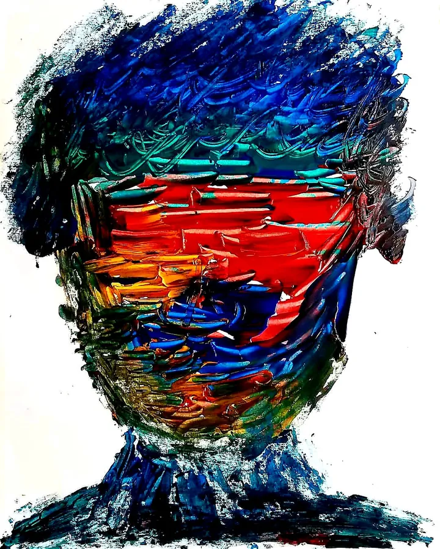

# Vanta

**Five notes. One chord.**

The portfolio of Christopher Woodyard: poems and physics, open research instruments, simulated worlds, paintings, and songs as Indigo People. Much of it is built at [Vers3Dynamics](https://vers3dynamics.com/), his open lab. Vanta is the person; the lab is where the work gets made.

[**Enter Vanta →**](https://mitpress.vercel.app/) · [**Open the research atlas →**](https://mitpress.vercel.app/research) · [**Listen to Indigo People →**](https://chriswoodyard.bandcamp.com/) · [Contact](mailto:christopher@vers3dynamics.com)

## Enter through a work

There is no correct order to visit a life. Pick a doorway, then follow the thread that connects it to another.

| Begin with… | Follow it to… |
| --- | --- |
| **A sound** | [Indigo People](https://chriswoodyard.bandcamp.com/): songs and recordings, some of which play inside the [Pine Gap world](https://github.com/topherchris420/satellite-vision-scape) |
| **An instrument** | [CIRCLE](https://github.com/topherchris420/circle): simulated biosignal traces, bounded decisions, and a still-unbuilt device |
| **A question** | [The research atlas](https://mitpress.vercel.app/research): papers, code and source-linked relationships with unreviewed claims clearly distinguished |
| **A world** | [Lop Nur Twin and R.A.I.N. Lab](https://github.com/topherchris420/lop-nur-twin): documented geography, a simulated city and bounded research |

<table>
  <tr>
    <td width="50%"></td>
    <td width="50%"></td>
  </tr>
</table>

*Two real works, not generated interface mockups. The profile is an instrument for moving between media, not a catalog of fabricated achievements.*

**Vanta is the person. Vers3Dynamics is the open research lab.** Where a work lives in both, the distinction matters: a studio experience can be complete as art while an experiment still needs independent validation.

### A mathematical question worth testing

**Does shared mathematical vocabulary cause unsupported provenance links in the research atlas?** The [proposed study](docs/MATH_RESEARCH.md) names assumptions, an existing baseline and a negative control. Candidate mathematics can be explored through [R.A.I.N.'s shared reference scout](https://github.com/topherchris420/lop-nur-twin/blob/main/docs/MATH_PORTFOLIO.md). **No additional mathematical capability has been demonstrated here yet.**

## The instrument

Five channels, five notes: **Writing** (C4), **Instruments** (E4), **Worlds** (G4), **Art** (C5), **Music** (G3). Each carries a few works. Every work leads with the question it asks, says what actually happened to it (Live, Open source, Preprint, Prototype, Recorded…), and links to the thing itself. Each channel shows one real artifact in its own medium: a claim from the location papers, the CIRCLE polygraph, a frame of an agent on the Pine Gap coffee run, an impasto painting with the *Green Machine* cover painting and a cymatics still, and fourteen seconds of *Green Machine*.

Scroll or use the arrow keys to tune a channel. Its frequency, visual state, and optional Web Audio tone move together. **Intervals** name the questions that keep recurring across channels (provenance, agency, translation, resonance). Tune one and its channels light together on the rail, and, with sound on, sound as a chord.

The hero stage is the Event Horizon Archive, a Three.js black hole holding the practice on one surface. Cross it to reach the research atlas.

Every visit starts silent. Sound needs an explicit action, and the page is complete without it. Reduced motion, mobile, hidden tabs, and unavailable WebGL each have their own rendering path.

## The research atlas

`/research` is the layer underneath: the papers, repositories, and records the work keeps returning to. It is a local catalog with weighted search, typo tolerance, and an interactive connection map.

- **Addressable sessions.** Query, discipline, era, connection filter, sort, view, and selected record live in the URL.
- **Private reading lists.** Saved in the browser, excluded from shared URLs, exportable as JSON.
- **Stated vs. inferred.** When records say they build on each other, the edge carries the sentence that says so. Every other record-to-record link is inferred from shared terms and labelled that way.
- **Back to the work.** Records that are, or describe, a portfolio work link to it on the home page.
- **Mobile and fallback views.** Records and map switch on small screens; reduced-motion and no-WebGL visitors get keyboard-accessible indexed nodes.

### What the catalog establishes

Christopher's own preprints are self-deposited on Zenodo or OSF and are **not peer reviewed**; each record says so. The catalog was audited in September 2026 and every record traced to its source (see [the diagnosis](docs/coherence-diagnosis.md)). That audit checked existence and attribution, not the claims inside any paper. **Inclusion is not verification.** Check the original before citing.

Legacy internal names (`verifiedOnly`, `Source Verified`, edge `verified`) are kept for data compatibility. The interface does not present them as verification.

## Run locally

Use Node.js 22 (minimum 20.9) and npm.

```sh
git clone https://github.com/topherchris420/vanta.git
cd vanta
npm ci
npm run dev
```

Production:

```sh
npm run build   # static export to out/
npm start       # serves out/ locally
```

Every page is static, and `next.config.js` sets `output: "export"`, so `next build` writes the whole site to `out/`. Vercel builds it as usual. For a static host such as dappling.network, use:

- Build command: `npx next build` (not `next build && next export`; Next.js 15 removed `next export`)
- Output directory: `out`
- Node: 22 (Node 16 and 18 are end-of-life)

## Quality checks

```sh
npm test
npm run build
```

The Node test suite covers the practice model (every claim has a receipt, statuses are factual, threads span channels, artifacts exist and stay light), catalog provenance, search, graph extraction, URL round trips, reading-list persistence, audio voicing and render policies, and rendered HTTP contracts for home, research, and 404. `scripts/browserChecks.js` drives a real browser through sound, tuning, and keyboard checks; see [the workbench notes](docs/research-workbench.md).

## Code map

| Area | Entry point |
| --- | --- |
| Channels, works, threads, now | `data/practice.js` |
| Practice integrity rules | `lib/practice.js` |
| Home page | `pages/index.js` |
| Channel, artifact, intervals | `components/ProjectChannel.js`, `components/ChannelArtifact.js`, `components/Intervals.js` |
| Signal state, rail, console, chord voicing | `lib/signalExperience.js` |
| Audio lifecycle | `hooks/useSignalAudio.js` |
| Event Horizon Archive | `components/DisplayPedestal.js`, `lib/eventHorizonArchive.js` |
| Research interface | `pages/research/index.js` |
| URL and reading-list contracts | `lib/research/workbench.js` |
| Search and graph extraction | `lib/research/searchEngine.js`, `lib/research/graphEngine.js` |
| Bundled catalog | `data/research/curatedKnowledge.json` |
| Design and behaviour contracts | `PRODUCT.md` |

## Updating the work

- Add or change a work in `data/practice.js`. It needs at least one evidence link and one to three statuses; `npm test` refuses anything else.
- Change `now` by hand when attention moves.
- Artifacts live in `public/work/`. Use real material only, and only images whose source says Christopher made them.

## Catalog maintenance

```sh
npm run sync:research          # fetch new arXiv/OpenAlex records
npm run ingest:neuro2          # refresh the Neuro2 mirror record's date
npm run build:research-graph   # rebuild the stored graph after hand edits
```

These are explicit maintenance commands, not background requests from a visitor's browser. Review metadata and source URLs before committing their output.

Built with Next.js, React, Three.js, react-force-graph-3d, and the Web Audio API. The *Green Machine* excerpt and cover painting are Christopher Woodyard's own work (Indigo People) and are not covered by any software licence in this repository.
