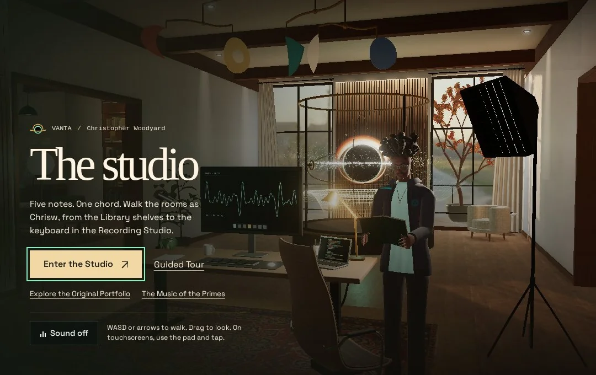
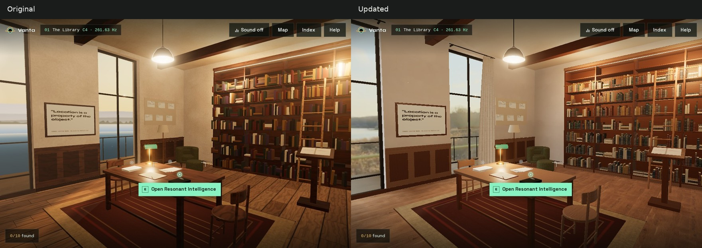
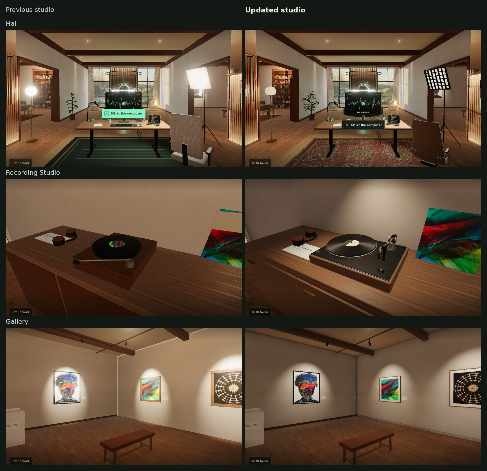

# The studio

`/studio` is the portfolio as a place you can walk around. It's a 3D studio built from
`data/practice.js`, with one room for each channel, the Event Horizon Archive in an
instrument of its own, and a computer you can sit down at. The home page and `/research`
are unchanged and work without it. The studio is one more way in.



Four brass pivots carry the five enamel shapes above the Hall. Their motion pauses with reduced motion enabled. Potted maples on the north and west terraces frame the lake from the Hall and Library.

## The audit

The studio began with a read of the existing site. This is what it found, and what the
studio does with each part.

**Kept as it is**

- `data/practice.js` is still the only source of content. The studio reads works, statuses,
  receipts, threads, the epigraph and `now` from it, and never restates them.
- The home page, `/research`, the 404 page and their tests. The only change to them is a
  Studio link in the nav and an extra `/studio` block in the rendered-page test.
- The sound contract. Every visit starts silent, nothing creates an `AudioContext` until
  the visitor asks for sound, chords are voiced and capped by `createChordVoicing` and
  `createStrum`, and the Green Machine excerpt never preloads or autoplays.
- The runtime contract: the pixel ratio is capped at 2 on desktop and 1.5 on phones,
  hidden tabs pause, reduced motion gets a still scene, and a WebGL failure falls back to
  text.
- The static export. Nothing new needs a server. `getStaticProps` reads the catalog and
  `docs/MATH_RESEARCH.md` at build time.
- The visual system: ink, surface, paper, mint and amber, Syne and Space Grotesk, mono
  metadata, hard edges and ruled lists.

**Extended**

- `lib/eventHorizonArchive.js` takes an `embedded` option. The studio mounts the same
  archive the home page uses, with the same shaders and detail tiers, inside its own scene.
  It passes the visitor's camera in, so the lensing, tilt and beaming follow you round it.
  The home page calls the archive exactly as before.
- The research atlas runs inside the computer's Atlas window, served from `/research`
  itself. Search, the connection map, stated and inferred links, URL state and the reading
  list are the real ones.

**New**

- `lib/studio/` holds the pure logic, all of it tested in node: the floor plan, walking and
  routes, graphics tiers, instruments, the library, the terminal and the page content.
- `lib/studio/scene/` holds the three.js scene.
- `components/studio/`, `hooks/useStudioAudio.js`, `hooks/useRecording.js` and
  `styles/Studio.module.css` are the interface.
- `scripts/studioBrowserChecks.js` runs the browser checks.

## How it fits together

| Area | Entry point |
| --- | --- |
| Floor plan, rooms, objects, discoveries, tour | `lib/studio/layout.js` |
| Walking, collision, routes, camera poses | `lib/studio/navigation.js` |
| Graphics tiers, frame governor, render policy | `lib/studio/quality.js` |
| Scope, plate, keyboard and tuning-game maths | `lib/studio/instruments.js` |
| The Library's volumes, markdown reader | `lib/studio/library.js` |
| Sandboxed terminal and its file tree | `lib/studio/terminal.js` |
| Everything the page shows, assembled | `lib/studio/content.js` |
| Renderer, lights, camera, picking, frame loop | `lib/studio/scene/index.js` |
| Walls, windows, sky, light shafts | `lib/studio/scene/architecture.js` |
| What is in each room | `lib/studio/scene/rooms.js` |
| Turned, bevelled and upholstered furniture | `lib/studio/scene/furniture.js` |
| Page state, panels, sound, tour | `pages/studio.js` |
| Desktop and its apps | `components/studio/Desktop.js`, `components/studio/apps/` |
| Object panels | `components/studio/panels/` |
| Text index (SSR, and the whole studio without WebGL) | `components/studio/StudioIndex.js` |

The page makes every decision: what's open, what's playing, what has been found. The scene
only draws and moves the camera. It exposes a small imperative API (`focus`, `release`,
`goto`, `setScope`, `setChord` and so on), never touches the DOM outside its host element,
and never plays sound.

`buildStudioLayout` refuses a practice model it can't house. A build fails if a work has no
object in its own room, a thread is hidden in a room it doesn't span, or a painting is hung
that the Art channel doesn't have. Add a work to `data/practice.js` without giving it a
place, and `npm test` says so.

## The rooms

| Room | Channel | What you can do |
| --- | --- | --- |
| The Library | Writing, C4 | Read Life of a Line (title page and a pointer to the paperback), the location papers, the research notebook (`docs/MATH_RESEARCH.md`), Resonant Intelligence, and every preprint the atlas credits to Christopher. Switch on the lamp. |
| The Workbench | Instruments, E4 | Drive the signal generator and watch the oscilloscope, in time or X–Y mode. Drive the resonance plate and watch the sand find its nodal lines. Strike the tuning fork. Read CIRCLE's polygraph, DRR's failed benchmark and the R.A.I.N. Lab card. |
| The Simulation Room | Worlds, G4 | Inspect the Pine Gap, Lop Nur and Mannahatta dioramas and launch the live sites. Look at the one real Pine Gap frame, labelled as a still. Pick up the person's controller. |
| The Gallery | Art, C5 | Look closely at the three works in the Art channel, under track lights, with their captions and associated works. Read the Rooms, Cymatics and Signal Lab cards. |
| The Recording Studio | Music, G3 | Play the two-octave synthesizer, with its five channel keys marked. Put on Green Machine. Patch the loose cable. |
| The Hall | rest | Sit at the computer. Sound the five chimes. Read the Now card. |
| Event Horizon Archive | rest | Change its index model, then cross into the atlas. |

Each room's pendant lamp hangs one wavelength of the room's note below the ceiling
(343 m/s ÷ frequency), so G3 hangs lowest. Each chime is cut to length as one over the
square root of its frequency.

## Musical structure

- When sound is on, walking into a room sounds its note once, from its pendant (spatially
  placed), and that pendant brightens.
- The five chimes sound the coda. All five pendants light, the HUD reads `∿ One chord`, and
  the chord's name comes from `nameChord`, as on the home page.
- Each thread is hidden in a room it spans. Finding it sounds its chord and lights its
  rooms:
  - Provenance: the reading lamp.
  - Resonance: the tuning fork.
  - Agency: the second controller. Its coda, "Two notes. The third is held by a person.",
    becomes a button that holds C4 under E4 and G4, which completes the triad.
  - Translation: a patch cable. Plugging it in makes the synthesizer drive the plate.
- **Resolve**, in the computer's Experiments app, is the playable game. The five strings
  arrive out of tune, and each strobe drifts until its string is right. With sound on,
  Listen plays the string against its true pitch so you can tune by the beating. When all
  five are in, the chord resolves.
- What the room shows (speaker cones, VU meters, the rack scope, pendant levels) is
  computed from what is being played: the synth's envelope, and the recording's stored
  loudness curve. It never comes from the audio output, so the room reacts the same with
  sound off.

## Getting around

- **Desktop:** WASD or the arrow keys, Shift to hurry, drag to look. Click an object to
  walk to it and use it, or press E for whatever is in front of you. M opens the map and
  Escape always returns you to your feet.
- **Phone:** a thumb pad to walk, drag to look, tap to use. The prompt is a button, panels
  are bottom sheets, and the desktop shows one window at a time.
- **Never stuck:** the HUD always shows where you are. The map sends you to any room, the
  index lists everything as text, and every panel has a Back to the studio button.
- Walking accelerates and coasts, and slides along walls. Routes to objects come from A*
  over the floor plan, then are straightened. When a panel is open, the camera's optical
  centre moves into the part of the room still visible, so the object stays in view.

## Honesty rules the studio keeps

- **No invented writing.** The Life of a Line volume holds its title page and says the
  poems are in the paperback. Preprint pages are the catalog's own records and say they
  are not peer reviewed.
- **Artwork and scenery.** The works on display come from `public/work/`. Photographic
  building materials and the landscape are credited below. Labels and instrument displays
  are drawn in the browser.
- **Simulations are labelled.** The scope and the plate say they are models, computed from
  their controls. The Pine Gap projection is labelled *Still frame, not a live feed*. The
  dioramas say they were made for the room, and so do the three plan drawings on the
  Simulation Room's monitors (*Drawn for the room · not a live feed*). The Workbench's
  mode table is computed from the same equation that drives the plate, and says so.
- **Furniture is furniture.** Chairs, a sofa, rugs, plants, lamps, acoustic panels, a
  diffuser, headphones and an audio interface make the place lived in. None of it is
  presented as Christopher's work or as a claim about him.
- **Live means Live.** The Experiments launcher only offers works whose status includes
  Live, through their own evidence links. CIRCLE, a prototype, isn't offered.
- **The terminal is a sandbox.** It's a fixed command table over a virtual tree built from
  the practice model. `..` above the root goes nowhere, and there is no eval, network or
  real file system. The only effects it can ask for are a closed list: open a window, walk
  to a room, sound the chord, leave.

## Look

The studio is a creative loft in the last hour of afternoon light.





- In the Recording Studio, the 25-note keyboard has full-size keys, a sloped instrument
  panel and four working knobs. The monitor cones travel along their voice coils. The
  turntable cues its stylus into the lead-in, tracks inward at 33⅓ rpm and lifts before
  returning to its rest. Platter phase follows the recording's playhead. On a narrow screen the camera
  pulls back to keep the deck and sleeve together, or to show both ends of the keyboard.
- The gallery's track heads aim at the displayed works. A floating frame leaves a shadow
  gap around the impasto portrait. A shallow bump map derived from the painting photograph
  approximates brush relief. The two paper mounts have bevelled openings and mitred wood
  frames.
- A laminated walnut chair curves from seat to back at the Hall desk. The softbox grid
  limits how much of its diffuser is visible from the side. Each patterned rug uses a
  different museum photograph and a separate weave map.
- **Surfaces.** Oak planks, walnut veneer and plaster use photographic colour and surface
  detail at a fixed scale in metres. Separate roughness maps control the finish on wood.
  The walnut grain follows long rails and vertical stiles. Woven seats and the pleated
  linen at the window have a fine normal map and a soft grazing highlight.
- **Windows.** Steel frames and a stone terrace stand in front of a photographed lakeshore.
  The sun in the panorama sits 8.44° above the horizon. Its position sets the direct light
  and the shafts through the panes.
- **Daylight.** A grid of 1,995 probes stores the direction and colour of skylight entering
  the openings and one diffuse bounce from the room shell. The same grid shades moving
  and fixed objects. Regenerate it with `node scripts/bakeStudioDaylight.mjs` when the walls
  or windows move. A separate one-time height capture gives nearby furniture soft contact
  shadows on the floor and all three rugs. A second atlas stores short-range ambient
  visibility on the walls, ceiling, desk, reading table and record cabinet. It was baked
  against the finished furnishings, so a shelf darkens the plaster behind it even on Light.
- **Light sources.** The sun, long and gold, laying the window grids across the floor and
  up the archive bay's east wall; recessed downlights, the ones near a wall throwing a
  scallop down the plaster; a spun charcoal-and-brass dome pendant in each room; a
  softbox key light; a globe floor lamp; a brass desk lamp; a green-glass banker's lamp on
  the Library table; a drum lamp in the Recording Studio; warm LED strips under shelves
  and along the walnut slat walls. Lamps near pale walls sit inside their shades, toward
  the room, so they don't burn hot spots into the plaster.
- **Bounced light.** A few frames after load, a probe in the middle of the Hall
  photographs the lit studio in every direction. That picture becomes everything's
  ambient light and reflection, so floor light reaches the ceiling and the sunset shows in
  the brass. The hemisphere fill is kept low so rooms keep
  their falloff: bright by the glass and the lamps, darker in the corners.
- **Post-processing.** High renders to a multisampled HDR buffer. Ground-truth
  ambient occlusion seats things in the room, light sources and the sun are drawn brighter
  than paper so they bloom, and one ACES pass tone-maps the result. The archive's shaders
  write display-ready colour, so the pipeline converts them to linear on the way out.
- **Furniture.** `furniture.js` builds pieces the way they are made: tub chairs whose
  barrel is an extruded, bevelled arc wrapping into the arms; a three-seat sofa with loose
  cushions; bent-back side chairs; a leather gallery bench; turned pedestal tables with
  marble tops; museum vitrines over the dioramas; lathe-turned planters; a quadratic-
  residue diffuser; fabric acoustic panels; jute rugs under the patterned ones. All of it
  is static, so it joins the merged batches and costs no extra draw calls per piece.
- **Interaction.** The use prompt sits on the object it's about, a ring marks anything
  nearby that can be used, and viewfinder corners frame the thing in reach.
- **The computer.** Sitting down glides the camera to the desk. On a screen at least
  1100 × 680 the desktop then grows out of the monitor into a bezelled screen with a faint
  glass sheen, and the room stays visible round it, held still and dimmed. On smaller
  screens it fills the view, one window at a time, as before.

## Scenery credits

The following [CC0 assets from Poly Haven](https://polyhaven.com/license) are served from
`public/materials/studio/`. The panorama was tone-mapped from HDR, the plaster tinted,
and the maps resized for the web.

| Studio surface | Source |
| --- | --- |
| Oiled oak | [Oak Wood Planks](https://polyhaven.com/a/oak_wood_planks) |
| Walnut joinery | [Walnut Veneer](https://polyhaven.com/a/walnut_veneer) |
| Plaster | [Plastered Wall 04](https://polyhaven.com/a/plastered_wall_04) |
| Textile weave | [Fabric Pattern 07](https://polyhaven.com/a/fabric_pattern_07) |
| View through the windows | [Lakes](https://polyhaven.com/a/lakes) |
| Leather surface grain and finish | [Leather Red 02](https://polyhaven.com/a/leather_red_02) |

The three rug images are public-domain collection photographs released through
[The Metropolitan Museum of Art Open Access](https://www.metmuseum.org/about-the-met/policies-and-documents/open-access).
Their backgrounds were removed and the images resized for the studio.

| Room | Museum object |
| --- | --- |
| Hall | [Star Ushak Carpet, 08.235](https://www.metmuseum.org/art/collection/search/445364) |
| Library | [Star Ushak Carpet, 22.100.110](https://www.metmuseum.org/art/collection/search/447568) |
| Recording Studio | [Star Kazak Carpet, 22.100.17](https://www.metmuseum.org/art/collection/search/447483) |

## Runtime

| Tier | Pixel ratio | Shadows | Post-processing | Bounced light | Accent lights | Plate grains | Frame cap |
| --- | --- | --- | --- | --- | --- | --- | --- |
| High | ≤ 1.5, 2× MSAA | sun 2048 and key light 1024, soft | AO and bloom | 1 bounce | yes | 9,000 | none |
| Balanced | ≤ 1.5 | sun 1024, soft | bloom | 1 bounce | yes | 5,000 | none |
| Light | 1 | cached sun 1024 | none | 1 bounce | gallery track and record shelf | 2,200 | 30 fps |

- Phones start on Light. Machines with 4 GB of memory or 4 cores start on Balanced.
- A frame governor steps down a tier after a sustained run of slow frames, never on a
  single long frame. It never steps back up by itself.
- Graphics can be set by hand under Help.
- Rendering stops while the tab is hidden or the desktop covers the room. Under reduced
  motion it draws only when something changes.
- All shaders are compiled before the first frame.
- Static geometry is merged by material. The library's shelf books share one texture atlas
  for cloth covers, cut page edges and stamped spines. All tiers reuse the static architectural shadow maps
  while the camera moves. High computes screen-space ambient occlusion at half resolution.
- Paintings and frames load progressively, and the room is usable before they arrive.
- Losing the WebGL context switches to the text index.

## Decisions

- **No React Three Fiber, Drei or GSAP.** The site already drives three.js imperatively
  (the archive, the atlas graph), and the studio reuses that archive directly. Most of the
  scene is static merged geometry, so a reconciler would add a second rendering model and
  bundle weight without much benefit. Glides follow routed paths with their own easing,
  which GSAP wouldn't simplify.
- **Post-processing by tier.** The first version had none, and it looked flat next to the
  reference: no contact shadows, no glow off the lamps. High now runs ambient occlusion
  and bloom, Balanced runs bloom only, and Light renders straight to the screen as before.
  Transparent and additive layers (glass, light shafts, the archive's platter and
  lensing) are left out of the occlusion so they don't darken what's behind them.
- **The atlas is the atlas.** The computer's Atlas window is `/research` in a frame, not a
  reimplementation, so its provenance distinctions and reading lists can't drift.

## Checks

```sh
npm test
npm run build && npm start &
npm i --no-save playwright-core
node scripts/studioBrowserChecks.js http://localhost:3000
node scripts/studioBrowserChecks.js http://localhost:3000 --no-webgl
node scripts/studioBrowserChecks.js http://localhost:3000 --reduced-motion
node scripts/studioBrowserChecks.js http://localhost:3000 --mobile
```

The browser checks cover the intro, walking and collision, the prompt, the computer and
its sandbox, the atlas window, the instruments with and without sound, the consent
contract, the threads, the chord, the record, the archive, the map, the tour, horizontal
overflow, and page errors. They run on the Light tier and wait on positions rather than
timings, because software rendering can manage only a frame or two a second.

After changing the walls, worktops or static furniture, run the surface-contact bake
against an up-to-date build or development server. It reads the actual static triangle
batches from `/studio?inspect`. Chromium and Blender with its Python Pillow module are
development tools for this step. Visitors download a single greyscale WebP.

```sh
node scripts/bakeStudioContact.cjs http://localhost:3000
```

## Known limitations

- The room and its furnishings are modeled. Flat maps supply fine surface relief, and
  the photographic shore has a fixed viewpoint beyond the modeled terrace.
- Changing tier at runtime can't rebuild the archive's geometry, so the detail tier chosen
  at load stays until the next visit.
- The terminal's `research` command uses the catalog's documents without the stored graph.
  The Atlas window has the full graph.
- Spatial audio uses HRTF panning where the browser supports it. Elsewhere sounds play
  unplaced.
- Frame rates have been measured only under software rendering (SwiftShader, 1–3 fps), and
  those numbers say nothing about GPUs. Draw calls and triangle counts are the comparable
  figures. Ambient occlusion is the most expensive addition. If High struggles on a given
  GPU, the frame governor drops to Balanced, which has no ambient occlusion.
- The Hall reflection probe updates after the surface assets load and when the graphics tier changes. The pendants brightening as you
  walk, and the reading lamp, change the direct light but not the bounced light.
- The sun is fixed at one hour of one afternoon. There is no time-of-day cycle.
- The framed desktop shows the room as it was when you sat down; the scene is paused
  behind it, as it was when the desktop covered the whole screen.

### Walking as Chrisw

Enter the Studio to walk as Christopher Woodyard’s 6 ft 1 in avatar. He reads by the desk
in the opening shot. Once you enter, your movement drives his stride and your look direction
guides his gaze. Walk to the glass to look outside, open a work in the Library, or sit at the
Hall computer. Object views keep the framing of the book, screen, or instrument.
Help → Walking view switches between the shoulder camera and first person.

The studio GLB packages the original CHRISW mesh, 32-joint skeleton, and four painted textures
from [the Pine Gap character](https://github.com/topherchris420/satellite-vision-scape/tree/49626bf71f56cf6db84c669e6a04accdb5a77865/gta-sa-99-9-percent-sure/assets/character).
